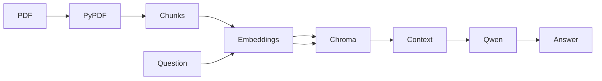

# Local RAG hackathon starter

Numeric grounding: the final streamed answer is checked sentence/bullet by sentence/bullet against its own citation IDs. Local evidence rows/sentences are aligned by bilingual topic anchors before comparing numbers. Arabic-Indic digits, decimal/thousands separators, percentages, fractions and simple English/Arabic number words are normalized with exact rational arithmetic. Equivalent proportions (e.g. one half and fifty percent expressed numerically) can match, while plain point counts are not interchangeable with percentages. List numbering is excluded; whitespace before a following citation does not detach it. Wrong citations, missing local citations, unsupported numbers, contradictory explicit units/bounds and invalid fractions remain rejected. Numeric failure diagnostics identify the expression and citation IDs without displaying the full claim. These are conservative structural/topic checks, not a semantic proof; ambiguous/complex language or poorly extracted tables still need human review.

Context focus: `rag/context_selection.py` contains a small extensible bilingual query glossary. It keeps already-retrieved sources covering every recognized query facet when at least two facets are recognized, and otherwise preserves the full candidate list. It changes neither the embedding model nor the retrieval distance threshold and never stores expected answers or score constants. On the bonus question it selects the page containing bonus eligibility instead of passing unrelated marketing/grading/presentation chunks. Limited glossary coverage and context completeness should be evaluated on new datasets.

Bonus diagnostics: `python -m tools.benchmark_bonus NAME` saves a full-context trace; append `--focused` to test the focused context. `python -m tools.compare_bonus_context` alternates full/focused runs with distinct neutral request identifiers to reduce shared-prefix cache bias, saving exact text locally in `data/debug/bonus_context_comparison.json`. Identifiers can influence small-model outputs, so this is a small latency experiment, not a statistical accuracy evaluation. `python -m tools.verify_bonus_ui` runs the production Streamlit path headlessly with the live model, requiring the eligibility proportion, a page-6 citation, validated history and multiple streamed UI chunks.

Arabic extraction now uses pypdf logical text runs ordered by their transformed PDF coordinates, with right-to-left ordering for Arabic lines and left-to-right ordering within adjacent Latin runs. Characters are never blindly reversed. NFKC folds presentation forms. This was regression-tested on page 3 of the public judging guide; complex multi-column/rotated PDFs still require review. PyMuPDF is available for comparison and rendering, not selected as the default extractor because it distorted spelling on that fixture. OCR is not implemented.

Developer diagnostics: `python -m tools.diagnose_rag run_name` runs three live questions and writes exact retrieved context, prompts, visible model content, validation reasons and timings into `data/debug/run_name.json`. These traces contain document text: keep them private. The folder is git-ignored; this is not encryption or an access-control boundary. Internal reasoning is not intentionally logged or displayed. Ollama server prompt processing, model loading and token-generation durations are distinguished from first visible content and total time. The live answer path does not run a blocking recovery call: failed validation discards the draft and displays an error/refusal. The evidence-first recovery helper is retained only for offline diagnostics. Citation IDs, numerical claims against cited text, and literal evidence quotes are checked; these checks do not prove semantic entailment.

To preview a targeted reindex: `python -m tools.reindex_pdf PATH_TO_PDF`. Add `--apply` only after reviewing extraction. It backs up this filename's records and vectors under `data/debug`, inserts and verifies replacement chunks, then removes stale records for that filename. Other documents are preserved. Re-uploading changed extraction without removing stale records can otherwise retain old chunks because IDs include text. Do not expose this app or its debug folder publicly.

Live checks: `python -m tools.verify_streamlit` exercises the actual app headlessly against the current index and Ollama; it expects the judging-guide fixture to be indexed. `python -m tools.verify_recovery` tests quote-checked recovery using the most recent `data/debug/final_checks.json`. These are fixture-specific developer checks, not a populated domain evaluation dataset. `python -m unittest discover -s tests` includes optional real-PDF tests, using `RAG_ARABIC_PDF` or the judging guide in Downloads. A missing fixture causes those tests to skip explicitly.

Latency: `ChatOllama.stream()` feeds a Python generator directly into `st.write_stream(stream.ui_chunks())`. Each visible chunk is yielded without sentence/citation buffering, sleeps, batching, or a typewriter simulation. Accumulation for history happens separately. The only held suffix is a possible split reasoning-control tag; reasoning bodies are suppressed. Provisional output uses RTL/LTR styling while streaming, is replaced after validation, and is never saved as a valid answer on failure or interruption. Generation uses a cached ChatOllama client with `reasoning=False` and a 10-minute Ollama keep-alive. Document/query embeddings and the index format are unchanged.

Run `python -m tools.verify_realtime_streaming` for live Arabic/English tests that instrument actual Streamlit Markdown enqueue calls while the provider iterator is still running. The metadata-only report is `data/debug/realtime_streaming.json`. It asserts multiple UI updates before model completion and captures outgoing `stream=true, think=false` requests. Retrieval and prompt preparation are separate from generation. First raw-token timing is at the LangChain boundary (content or exposed reasoning), not an internal Ollama sampling timestamp. First visible-token time excludes reasoning and is reported separately; UI enqueue timing excludes browser network/paint latency. The test is headless and does not prove browser paint timing. Cold model loading and prompt cache state can dominate latency even with genuine streaming.

Upload text-based PDFs, index page-level chunks in Chroma, retrieve with multilingual Sentence Transformers, and answer with local Ollama Qwen. The project is domain neutral.

## Windows setup

Use Python 3.12. The existing `.venv` is preserved. If its interpreter path is broken, repair or recreate it with a valid Python 3.12 install before running commands. Activate with `.\.venv\Scripts\Activate.ps1`, then `pip install -r requirements.txt`. Start Ollama with `ollama serve` in another terminal and check `ollama list` for `qwen3:1.7b` (`ollama pull qwen3:1.7b` if missing). Run `streamlit run app.py`.

Upload one or more PDFs in the sidebar and click **Index documents**. Ask a question in either language. Open source expanders to inspect retrieved text. **Reset index** removes indexed chunks; **Clear chat** removes session messages.

The first indexing run downloads `sentence-transformers/paraphrase-multilingual-MiniLM-L12-v2` into the local Hugging Face cache. Set `HF_HOME` to choose its cache directory. Copy `.env.example` to `.env` and adjust values. The default 800-character chunks with 120-character overlap preserve page metadata and limit page crossing. Change `rag/chunking.py` to replace the splitting strategy. Cosine distance above `RAG_MAX_DISTANCE` is rejected; tune it against real evaluation questions. Retrieval functions are isolated so hybrid search or reranking can be added.

For evaluation, populate all ten entries in `evaluation/questions_template.json` with verified questions, reference answers, and `expected_sources` such as `[{"source":"manual.pdf","page":2}]`. Mark at least one out-of-scope case. Run `python -m evaluation.evaluate`; inspect `evaluation/report.json`. Precision@k is computed from document/page matches. Faithfulness needs human review against excerpts; citation format alone cannot prove it. No evaluation results are claimed before real documents are supplied.

Run unit tests with `python -m unittest discover -s tests`. The business and slide worksheets are `BUSINESS_TEMPLATE.md` and `PRESENTATION_TEMPLATE.md`.

Limitations: scanned PDFs need OCR; tables and right-to-left extraction depend on PDF text quality. The relevance cutoff is heuristic. A cited answer may still be unsupported, so review demo answers. First model download needs internet, while later inference is local. Only text PDFs are supported. The interface offers Arabic labels and basic RTL behavior but needs visual review with actual Arabic content.

AI usage disclosure: Codex drafted the architecture, implementation, documentation, and templates; the team must verify outputs and supply domain evidence. No third-party code or sample dataset was copied into this repository. Runtime dependencies retain their respective upstream licenses.
